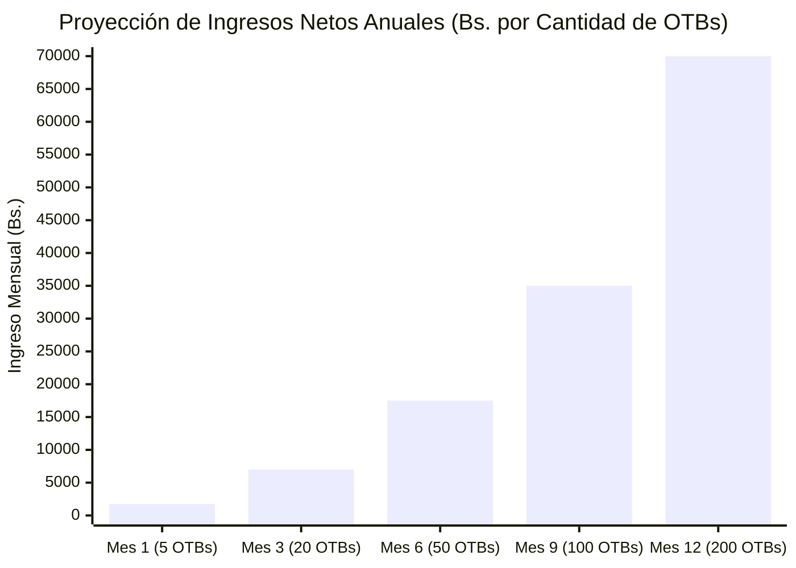

# 📊 MODELO DE IMPACTO, VIABILIDAD Y SOSTENIBILIDAD ECONÓMICA — XENTRA OTB v3.0

> Documento estratégico para evaluación del jurado de Hackathon en las categorías de **Impacto Social, Viabilidad Técnica, Modelo de Negocio y Escalabilidad**.

---

## 1. 🌍 IMPACTO SOCIAL Y COMUNITARIO MEDIBLE

### Comparativa: Situación Tradicional vs Con XENTRA OTB

| Indicador Clave | Gestión Tradicional (Cuadernos / Excel / WhatsApp) | Con XENTRA OTB v3.0 | Impacto Directo |
| :--- | :---: | :---: | :--- |
| **Tasa de Recaudación Puntual** | 35% - 45% | **92% - 95%** | Incremento de más del **100% en ingresos** para obras comunitarias. |
| **Tiempo Invertido por el Tesorero** | 25 a 35 horas al mes | **Menos de 2 horas al mes** | Ahorro del **94% de tiempo** administrativo por mes. |
| **Conflictos y Sospechas en Asambleas** | Frecuentes (discusiones por opacidad contable) | **Reducidos a prácticamente 0%** | Auditoría matemática abierta con libro mayor TRACE y facturas públicas. |
| **Tiempo de Respuesta a Incidentes Barriales** | 45 a 90 minutos | **Menos de 5 minutos** | Notificación sonora inmediata con foto y coordenadas GPS satelitales. |
| **Exposición de Privacidad de Vecinos** | Crítica (listas con nombres y deudas en postes y chats) | **100% Protegida (Zero-PII)** | Consulta privada por código de lote o CI; nombres ofuscados (`J*** J***`). |
| **Consumo de Papel y Talonarios Físicos** | 200 a 400 hojas de talonario al año por OTB | **100% Digital y Ecológico** | Cero extravíos de comprobantes, recibos verificables con código QR. |

---

## 2. 💰 MODELO DE NEGOCIO Y ECONOMÍA UNITARIA (UNIT ECONOMICS)

Xentra OTB no requiere donaciones ni subsidios gubernamentales para su operación. Su modelo se basa en un **micro-canon comunitario autosustentable**:

### A. Estructura de Ingresos
- **Micro-canon mensual:** **Bs. 1,00 por lote/vivienda al mes** (incorporado de manera transparente en la expensa de mantenimiento comunal).
- Para un vecino, **Bs. 1 al mes** es una cifra insignificante (menos de lo que cuesta un pan de batalla), pero para la plataforma representa sostenibilidad financiera a escala.

### B. Análisis por OTB Típica (350 Lotes)

| Concepto Financiero | Monto en Bolivianos (BOB) | Equivalente en Dólares (USD) |
| :--- | :---: | :---: |
| **Ingreso Bruto Mensual (350 lotes × Bs. 1)** | **Bs. 350,00** | **$50,00 USD** |
| Costo Servidores Edge (Vercel Hobby / Pro prorrateado) | Bs. 7,00 | $1,00 USD |
| Base de Datos PostgreSQL Multi-tenant (Supabase) | Bs. 10,50 | $1,50 USD |
| Almacenamiento S3 de Vouchers y Recibos TRACE | Bs. 3,50 | $0,50 USD |
| Notificaciones Push y Alertas WebSockets | Bs. 0,00 | $0,00 USD (Capa gratuita) |
| **Costo Operativo Total por OTB al Mes** | **Bs. 21,00** | **$3,00 USD** |
| **MARGEN OPERATIVO BRUTO POR OTB** | **Bs. 329,00 (94%)** | **$47,00 USD (94%)** |

### C. Proyección Financiera a 12 Meses

- Con **200 OTBs activas** (apenas el 1.4% de las 14,000 OTBs de Bolivia), la plataforma genera **Bs. 70.000 al mes ($10.000 USD/mes)** con costos de infraestructura inferiores a **$600 USD**, permitiendo reinvertir en soporte presencial y desarrollo continuo.

---

## 3. 🎯 COMPARATIVA COMPETITIVA: ¿POR QUÉ XENTRA ES ÚNICO?

| Característica / Criterio | Sistemas para Edificios (ej. Munily, Kastor) | Software Contable (ej. Siigo, Contasys) | Hoja de Cálculo (Excel / Google Sheets) | **XENTRA OTB v3.0** |
| :--- | :---: | :---: | :---: | :---: |
| **Diseñado para la realidad de OTBs bolivianas** | ❌ (Hecho para condominios de lujo) | ❌ (Empresarial rígido) | ⚠️ (Manual y desordenado) | **✅ 100% específico para OTBs** |
| **Costo mensual por familia** | $3 a $8 USD/mes (Muy caro) | $30 a $100 USD/mes | "Gratis" (pero con alto costo de horas hombre) | **Bs. 1/mes ($0.14 USD)** |
| **Cobro por QR Simple Bolivia sin comisión** | ❌ (Cobran 3% a 5% por tarjeta) | ❌ | ❌ | **✅ Directo OTB (0% comisión)** |
| **Sello Criptográfico Inmutable (TRACE)** | ❌ | ❌ | ❌ (Fácilmente editable) | **✅ SHA-256 Tokenizado** |
| **Modo Senior para personas de 40 a 60 años** | ❌ | ❌ | ❌ | **✅ WCAG AAA (Contraste 7:1, botones >56px)** |
| **Canal de Auxilio y Muro Barrial 24/7** | ⚠️ Parcial | ❌ | ❌ | **✅ Con GPS satelital y fotos** |
| **App Móvil Standalone sin Play Store (APK)** | ❌ | ❌ | ❌ | **✅ Compilada en GitHub Actions** |

---

## 4. 🛡️ MATRIZ DE RIESGOS Y ESTRATEGIAS DE MITIGACIÓN

| Riesgo Identificado | Nivel de Impacto | Probabilidad | Estrategia de Mitigación en Xentra |
| :--- | :---: | :---: | :--- |
| **Resistencia al cambio tecnológico en vecinos mayores** | Alto | Media | Implementación del **Modo Adultos (A+)**, eliminación de anglicismos y botón *"Guardar QR en Galería"* con guía paso a paso. |
| **Cortes de internet o fallas de conectividad móvil** | Medio | Media | Arquitectura **Offline-First** con DexieDB/IndexedDB; consulta de recibos y datos clave sin conexión activa. |
| **Desconfianza hacia la seguridad digital de los aportes** | Alto | Baja | Xentra **no custodia dinero ni cobra comisiones**; el dinero va directo al banco de la OTB mediante QR Simple nacional. |
| **Falsificación de comprobantes de pago** | Alto | Baja | Doble control: cotejo visual del tesorero contra extracto bancario + emisión de recibo oficial con hash SHA-256 no falsificable. |
| **Pérdida de continuidad al cambiar la Mesa Directiva** | Medio | Alta | La OTB conserva la personería y registros de forma histórica e institucional; el nuevo presidente hereda el padrón intacto. |

---

## 5. 🚀 HOJA DE RUTA (ROADMAP) POST-HACKATHON

- **Fase 1 (Semanas 1 a 4):** Despliegue del piloto oficial en 5 OTBs de Cochabamba (Distrito 4: Villa Esperanza, Chávez Rancho, Temporal).
- **Fase 2 (Meses 2 a 4):** Firma de convenio de cooperación con la Dirección Municipal de Seguridad Ciudadana para enlazar alertas de luminarias con el sistema de mantenimiento edil.
- **Fase 3 (Meses 5 a 8):** Expansión a 50 OTBs en La Paz, El Alto y Santa Cruz mediante la red de juntas vecinales distritales.
- **Fase 4 (Meses 9 a 12):** Integración con micro-firmas digitales descentralizadas para actas de asambleas notariales.
